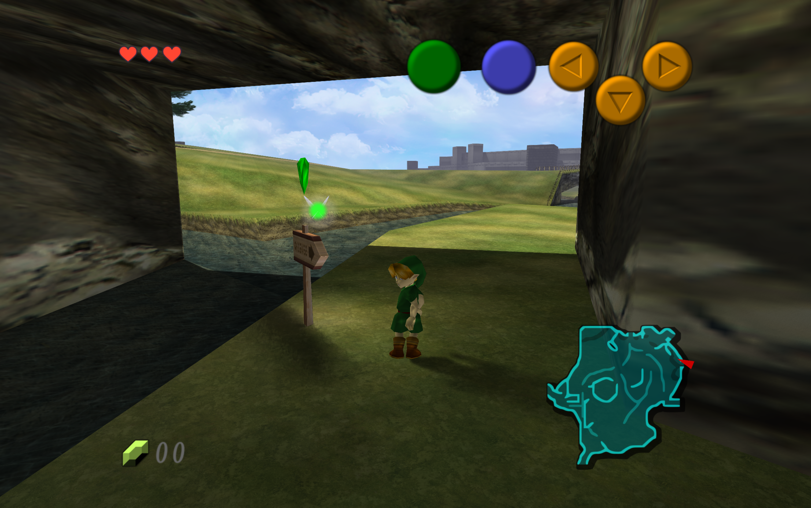
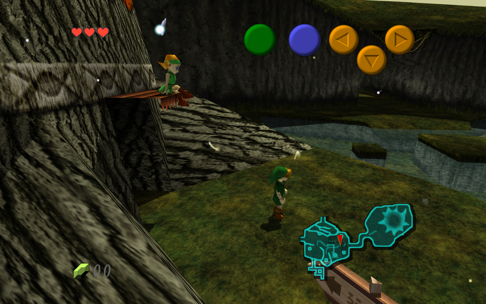
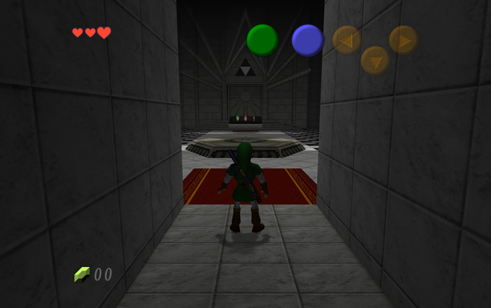

# OoT: Recompiled — macOS gameplay experiment

- Ocarina of Time has been brought to Apple Silicon through Metal, based on [JonB-Dev's OoT: Recompiled 0.6.1](https://github.com/JonB-Dev/oot-recompiled). Ray-traced shadows, local lights, ambient occlusion, widescreen, saves, and replacement textures have been exercised on this Mac.
- The source and experiments have been produced with AI assistance. Original authorship and credits have been retained; this fork is experimental.

## Start here: turn your ROM into a Mac app

- **The short version:** install the one-time prerequisites below, download this branch, double-click **Build macOS App.command**, drop in your ROM, and click **Build app**. When the build and tests finish, **Open app** becomes available.
- **What is provided:** source code and a native Mac builder. The game app is compiled on your Mac; no ready-made game download is provided. The ROM is supplied by you and is verified locally, never uploaded.
- **What is optional:** replacement textures and fancy lighting. Neither is needed to build the standard Metal app. Fancy lighting requires an additional Apple download.
- **What has been tested:** Apple M5, 10-core GPU, 32 GiB unified memory, macOS 26.7.1. A GUI-triggered build and its native tests have passed on this prepared Mac. A completely fresh Mac setup, other Macs, and hours-long gameplay have not been validated; a minimum specification has not been established.
- **Jump to:** [one-time setup](#one-time-setup) · [build the app](#build-the-app) · [start-playing settings](#start-playing-and-find-the-settings) · [help with problems](#if-something-does-not-work) · [gameplay captures](#gameplay-captures) · [benchmarks](#native-gameplay-on-the-connected-1440p-monitor).

### One-time setup

- **Mac and space:** an Apple Silicon Mac, an internet connection for source/tool downloads, and at least **30 GiB of free space** are required before building. Xcode and downloaded dependencies also use disk space.
- **ROM:** an unmodified **North American / USA (NTSC-U) version 1.0 ROM in `.z64` format** is required. A `.zip`, `.v64`, `.n64`, another region, or another revision will not pass validation. Renaming a file to `.z64` does not convert it. No ROM is supplied or downloaded by the builder.
- **Xcode — install this before opening the builder:** obtain full [Xcode from Apple](https://developer.apple.com/xcode/), open it, and finish its first-run setup. In **Xcode → Settings → Locations → Command Line Tools**, select the installed Xcode. Install **Metal Toolchain** through Xcode’s Components settings if it is missing. The smaller Command Line Tools package alone is insufficient for the game build.
- **Homebrew:** install [Homebrew](https://brew.sh/) using its official instructions. Its first-time installation may require Terminal. After Homebrew is available, the builder’s **Install build tools** button handles the remaining packages after confirmation: CMake, Ninja, LLVM, lld, Make, Git, SDL2, FreeType, and Python. If Python was installed or updated, close and reopen the builder before continuing.
- **Fancy lighting only:** Apple’s **Metal Shader Converter 4.0 beta 3** package is required for the tracing app shown in this experiment. Use **Get Apple converter** in the builder, or [Apple’s downloads page](https://developer.apple.com/download/all/?q=Metal%20Shader%20Converter); an Apple account may be needed. Obtain the exact version, review its license, then use **Select Apple converter…** to select its `.pkg` file. Acceptance is requested before local extraction, and its signature and checksum are checked. The converter is not bundled here.
- **Prefer to skip the converter?** Uncheck **Include fancy lighting** in the builder. A standard Metal app can still be built and played, including replacement textures; extra lighting effects will be unavailable in that build.

### Build the app

- **Step 1 — download:** open the [macOS experiment branch](https://github.com/boscacci/oot-recompiled/tree/codex/macos-experiment), select **Code → Download ZIP**, and unzip the download. Keep the extracted folder somewhere you intend to keep the game. A Git clone of this branch also works.
- **Step 2 — open the builder:** in that folder, double-click **Build macOS App.command**. This launcher compiles the small builder locally and opens **Build OoT for Mac**. A Terminal window may appear while it starts; ordinary build commands do not need to be typed. Keep the launcher with the rest of the extracted files.
- **Step 3 — add your ROM:** drag the `.z64` file into the ROM box, or click **Choose ROM…** and select it. The exact ROM revision is checked when building starts.
- **Step 4 — choose lighting and check setup:** leave **Include fancy lighting** checked for the tracing app, or uncheck it for the standard app. Click **Check setup**. Any missing prerequisites are listed in the lower log area. Complete the indicated setup, then check again.
- **Step 5 — build:** click **Build app**. The ROM is verified, required source dependencies are downloaded, the app is compiled, and native tests are run. The window can be minimized while work continues. The first build can take a while; no cold-build time estimate has been validated. Details are shown in the scrolling log.
- **Step 6 — play:** after **Your app is ready** is shown, click **Open app**. On first launch, select the same ROM in the game if requested. **Show app in Finder** reveals the generated `.app`; an alias can be kept for later launches. The builder does not need to be run every time you play.
- **Stopping and retrying:** **Cancel** stops the current build and its compiler processes. After it stops, the problem can be corrected and **Build app** selected again. Completed downloads/build work can be reused. Only one builder task is allowed in the same source folder at a time.
- **Keep the app’s dependencies:** this app currently uses Homebrew’s SDL2 and FreeType on the build Mac. Keep those installed. The generated bundle has not been packaged as a self-contained app for copying to other Macs.

### Where the app is saved

- **Use Show app in Finder** after a successful build; no build-folder knowledge is needed for normal use.
- **From a ZIP download:** the source is downloaded into `build/source/` inside the extracted folder. The fancy-lighting app is saved at `build/source/build/rt-compile-probe/OoTRecompiled.app`; the standard app at `build/source/build-cmake/OoTRecompiled.app`.
- **From a Git clone:** the fancy-lighting app is saved at `build/rt-compile-probe/OoTRecompiled.app`; the standard app at `build-cmake/OoTRecompiled.app`.
- **Source version:** a ZIP-based build obtains the experiment branch when its source checkout is first created, then retains that checkout on retries. A Git clone is built at its current revision. The source commit is shown in the build log. Neither path silently updates the checkout on every retry. Script-based reproduction is described in the [macOS notes](docs/macos-port.md).

### Start playing and find the settings

- **Open the game’s menu:** press **F1**, or **Back/Select** on a mapped gamepad. Select **Graphics** in the left sidebar while playing; the monitor icon opens Graphics in the launcher. These are the game’s settings, separate from the builder window.
- **Picture quality — Low / Medium / High:** High gives the sharpest picture. Lower this if gameplay feels slow.
- **Textures — Original / Enhanced / Maximum:** Original uses the game’s artwork. Enhanced uses a lighter version of an installed texture pack; Maximum uses its full detail. A pack must be installed before Enhanced/Maximum can be used.
- **Lighting effects — Off / Low / Medium / High:** richer light and shadows can be turned up separately, or reduced for smoother play. These options require the fancy-lighting build and supported hardware.
- **Advanced settings:** resolution, antialiasing, pack selection, and individual lighting effects are tucked away here. The section is collapsed by default. Each simple control is saved independently; other groups are preserved when a choice is changed.
- **Text too small?** Open **F1 → Settings → Interface size** and increase it. **150%** was used to make the menus and frame-rate counter readable on the tested Mac. This changes interface size, not the game’s rendering quality.
- **Tested starting point:** on the M5 with the external **2560×1440 monitor**, **High picture / Maximum textures / High lighting** held the original 20 fps in the recorded short scene probes. This is not a performance guarantee for the higher-resolution built-in display or other Macs. Lower picture quality or lighting if needed. The 60 fps path remains problematic.
- **Keyboard:** movement is WASD; A is Space; B is Left Shift; Z-target is Q; Start is Return; C buttons are IJKL. Bindings can be inspected or changed in **Controls**. An 8BitDo Ultimate wireless controller was recognized over Bluetooth with SDL’s built-in mapping; physical button/stick behavior and rumble have not yet been confirmed.
- **Texture packs:** packs are optional and obtained separately. Place an RT64 `.rtz` pack in `~/Library/Application Support/OoT Recompiled/texture-packs/`, restart the game, and choose Enhanced or Maximum. A particular pack can be selected under **Graphics → Advanced settings → Texture pack**. **Your files** opens the app’s data location.
- **Saves:** user data is stored in `~/Library/Application Support/OoT Recompiled/`. Existing saves should be backed up before an experimental build is used. ROMs, saves, texture packs, and the Apple converter are not distributed with this source.

### If something does not work

- **The builder does not open:** full Xcode must be installed and its initial setup completed. Double-click **Build macOS App.command** from the extracted source folder, rather than moving it elsewhere. Any startup error is shown in its Terminal window.
- **Check setup reports missing tools:** use the corresponding setup link or **Install build tools**, then check again. If Python was updated, reopen the builder. Xcode and Homebrew have their own first-time setup; the builder does not bypass it.
- **The ROM is rejected:** confirm USA / NTSC-U version 1.0 and `.z64` format. Validation is exact; a different revision or a patched ROM cannot be used for this build.
- **The converter is rejected:** the pinned version is **4.0 beta 3**, reporting tool version **4.0.3**. A different package will not pass its checksum check. The standard app can be built with **Include fancy lighting** unchecked.
- **The build fails:** the reason is shown in the lower log area. Correct it and retry; retain the source folder so completed work can be reused. If a source download is reported as incomplete, inspect the indicated `build/source` folder before retrying; unrelated files are not automatically deleted.
- **Open app is unavailable:** it is enabled only after a successful build in the current builder session. For an app built earlier, use its saved `.app` or Finder alias.
- **Need help reproducing a failure?** Record the source commit, Mac model, chosen lighting option, and relevant error text. ROMs and saves should not be attached, and personal paths should be removed from shared logs.

## Gameplay captures

- Original 3024×1898 output captures are shown with Full-detail [OoT Reloaded v11.0.0 for RT64](https://github.com/GhostlyDark/OoT-Reloaded/releases/tag/v11.0.0) and level-2 tracing. **Hyrule Field:** 2294×1440 internal render, 4× AA, four AO rays. **Forest and temple:** 3059×1920 internal render, 2× AA, two AO rays. Capture pixels have been preserved through lossless PNG compression; no image enhancement has been applied.
- Texture-pack credit is owed to GhostlyDark and the contributing artists. The pack is obtained separately; it is not bundled here. Capture settings and checksums are recorded with the [benchmark data](docs/benchmarks/2026-11-09-m5.json).

## Visual settings on this M5

- **Simple controls:** Picture quality, textures, and lighting are independent and saved when selected. High gives the sharpest picture; Medium and Low leave more room for smooth play. Enhanced textures use a lighter version of the selected pack; Maximum uses its full detail. Original uses the game's own textures. An installed pack is required for Enhanced/Maximum. Extra lighting can be reduced or switched off separately. Existing window and aspect-ratio preferences are preserved.
- **Advanced is optional:** Resolution, antialiasing, individual lighting effects, pack selection, and other fine-tuning remain under **Advanced settings**, collapsed when Graphics is opened. A group is shown as Custom when its settings do not match a preset. Choosing a preset resets only that group. No automatic hardware-based guarantee is implied.
- **For reproducing measurements:** High picture quality uses native resolution and 8× AA; Medium uses native resolution and 2× AA; Low uses 1080p and 2× AA. All use the original 20 fps target, original draw distance, and no downsampling. Low lighting uses traced shadows; Medium adds local lights and two AO rays; High uses four AO rays. Level-3 effects remain in Advanced. Diagnostic `--rt-level` overrides take precedence over the lighting menu; they should be omitted for ordinary play.

- **Earlier internal-display starting point:** Fullscreen, Resolution **1440p**, aspect **Expand to the window**, Frame rate **Original (20 fps)**, Texture detail **Full**, antialiasing **4×**, four occlusion rays, and the level-2 tracing launch above. Shadows, local lighting, and AO are retained; downsampling is disabled. About 20 presents/s were measured in the heavier child-field trial at these settings.
- **Earlier internal-display measurements:** A sharper internal picture is provided by Resolution **Match the window**, **2×** antialiasing, and **two** AO rays, with roughly 15–20 presents/s across the tested views. Antialiasing can be set to **Off** for additional headroom. A locked 20 fps across the whole game has not been established, and the 60 fps path remains problematic.
- **Session limits:** A 300-second guarded run covered Hyrule Field → Kakariko Village → Temple of Time → Hyrule Field without a detected driver fault; startup and transitions are included in that duration. Native 2×-AA samples were around 16 presents/s in Kakariko and 19–20 in the adult field and temple. Broad game progression, hours-long sessions, and level-3 lighting have not been validated. Isolated test profiles were used; normal saves were preserved.

## Native gameplay on the connected 1440p monitor

- **M27Q, native 2560×1440 at 60 Hz · M5 · AC power · Low Power Mode off.** Full textures and level-2 tracing were retained. These are separate from the higher-resolution internal-display measurements below.
- **Recommended here: Graphics → High picture quality, Maximum textures, High lighting**, corresponding to 8× AA and four AO rays. The highest AA option was retained; eight AO rays exceeded the frame budget in Kakariko. The starting 2×-AA/two-AO-ray field profile already held 20 fps; visual quality was raised while retaining that target. No renderer speedup is claimed.

| Scene / setting | AA / AO rays | Mean presents/s | Mean interval | Worst interval | Run |
|---|---:|---:|---:|---:|---:|
| Hyrule Field / starting profile | 2× / 2 | 20.00 | 50.01 ms | 56.87 ms | 120 s |
| Kakariko / too heavy | 8× / 8 | 16.67 | 60.01 ms | 62.13 ms | 120 s |
| Hyrule Field / quality trial | 4× / 4 | 19.96 | 50.03 ms | 56.84 ms | 120 s |
| Kakariko / longer trial | 4× / 4 | 20.00 | 49.99 ms | 55.84 ms | 300 s |
| Kakariko / selected quality | 8× / 4 | 20.00 | 50.01 ms | 54.77 ms | 180 s |

- The table uses the same warm comparison window, samples 69–92. Across the longer 8×-AA/four-AO window (samples 69–178), 20.00 presents/s were averaged, with 20–20 per sample and a 54.84 ms worst interval. The five-minute 4×-AA/four-AO run averaged 20.00 over samples 69–298, with a 59.11 ms worst interval. Startup is excluded from these windows but included in run durations.
- The final-build quality comparisons were run at `0c48b7f`; the initial profile was run at `16d8aeb`. Settings were subsequently exposed through the simplified quality controls. These are stationary scene probes; broad progression, other displays/Macs, thermal equilibrium, and hours-long play are unqualified. Frame-percentile claims are not inferred from one-second means. [Method and reproduction](docs/benchmarks/2026-11-09-m5-native.md), [commit/binary identity and results](docs/benchmarks/2026-11-09-m5-native.json), and [per-second samples](docs/benchmarks/2026-11-09-m5-native.csv) are provided.

## Earlier internal-display benchmarks

- **2026-11-09 · Apple M5, 10 GPU cores · 32 GiB · macOS 26.7.1 · code [`f4917e9`](https://github.com/boscacci/oot-recompiled/commit/f4917e965badd60c3573b6a8cd2b3f4083058e68).** Output was 3024×1898; internal render sizes are listed below. Full-detail textures, level-2 tracing, and the original NTSC 20 fps target were selected in every row.
- The same save and scripted input were used within each scene comparison. Samples cover seconds 69–92. All seven individual runs and the separate scene tour passed the driver-fault and process-memory watchdogs; run durations include startup and file selection.

| Scene | Internal render | AA / AO rays | Mean presents/s | Median interval | Peak process RSS | Run |
| --- | --- | ---: | ---: | ---: | ---: | ---: |
| Kokiri Forest | 3059×1920 | Off / 2 | 19.88 | 50.03 ms | 1310 MiB | 120 s |
| Kokiri Forest | 3059×1920 | 2× / 2 | 19.67 | 50.58 ms | 1328 MiB | 120 s |
| Kokiri Forest | 3059×1920 | Off / 4 | 17.62 | 55.17 ms | 1322 MiB | 120 s |
| Kokiri Forest | 3059×1920 | 8× / 2 | 15.00 | 66.81 ms | 1233 MiB | 120 s |
| Temple of Time | 3059×1920 | 2× / 2 | 20.00 | 49.99 ms | 1144 MiB | 120 s |
| Hyrule Field (child) | 3059×1920 | 2× / 2 | 15.50 | 65.24 ms | 1208 MiB | 110 s |
| Hyrule Field (child) | 2294×1440 | 4× / 4 | 20.00 | 50.00 ms | 1307 MiB | 120 s |

- Timing was measured from actual presentation, rather than the menu's refresh counter. The interval column summarizes one-second means, not individual-frame percentiles. Recording adds overhead; cache, thermal, and power conditions were not controlled across these sequential single runs. The final power check reported battery power with Low Power Mode off. RSS excludes some GPU allocations. Per-second samples and reproduction settings are provided in the [benchmark data](docs/benchmarks/2026-11-09-m5.json).

## Credits and source

- The original OoT: Recompiled project is credited to **Jonathan Barnes**. Its 0.6.1 source at `e5c6edd` was used as the base for this macOS experiment.
- **N64Recomp** and **N64ModernRuntime** are credited to Wiseguy and contributors; **RT64** to its contributors; **Zelda 64: Recompiled** as the reference implementation; and **zeldaret/oot** for the decompilation and symbol information.
- Source is provided under **GPL-3.0**; see [COPYING](COPYING). Dependencies are provided under their own licenses. Game artwork remains credited to Nintendo and texture-pack artwork to its artists. The README screenshots are illustrative; ROMs, texture packs, and generated game code are excluded from the repository.
